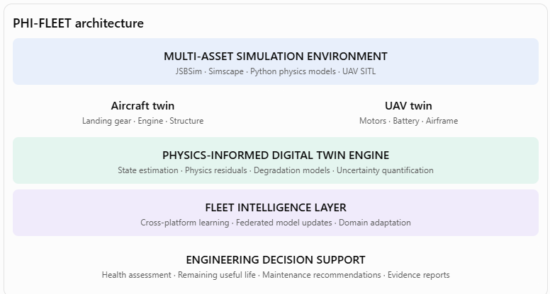

<div align="center">

# ✈ PHI-FLEET

### Physics-Hybrid Intelligence for Federated Aerospace Fleet Health

[](LICENSE)
[](pyproject.toml)
[](docs/ARCHITECTURE.md)
[](docs/RESEARCH_THESIS.md)
[-success.svg)](tests/)

**A unified, physics-constrained digital twin framework hosting heterogeneous aerospace asset twins across commercial transport aircraft, military airframes, and autonomous UAV fleets.**

[**Mohammed Bello Sani (Sm-bello)**](https://github.com/Sm-bello)  
*Lead Architect & Principal Researcher*  
`bellosani2drescue@gmail.com`

---

</div>

## 📌 Executive Summary & The Problem

Today, aerospace Prognostics and Health Management (PHM) is fragmented across isolated, non-interoperable application silos:
- An aircraft **landing gear** monitoring system runs a dedicated oleo-pneumatic stroke model.
- An **engine** health monitoring system runs an isolated gas-path thermodynamic model.
- A **UAV electric propulsion** system runs a separate brushless motor and battery diagnostic script.

### The Scientific Challenge
These technologies are not interoperable, and their models **cannot transfer reliably** between different aircraft, components, or operating environments. A model may achieve high classification accuracy on a benchmark training dataset, yet catastrophically fail in real-world operations when operating conditions shift. 

Furthermore, aerospace operators and defense forces cannot share raw in-flight telemetry due to proprietary restrictions, ITAR regulations, and mission confidentiality.

### Recent 2026 Baseline & Our Scientific Contribution
While recent 2026 literature in *Aerospace Science and Technology* has addressed consistency-centred simulation-to-reality transfer for single-type UAV PHM, **simply claiming cross-domain UAV digital twins is no longer defensible.**

**PHI-FLEET establishes the untrodden first-mover path:**  
The experimentally validated combination of:
1. **Heterogeneous cross-asset transfer** between completely different physical subsystems (e.g. aircraft landing gear & turbofans $\leftrightarrow$ UAV electric propulsion & batteries).
2. **Evidential physics-residual disentanglement** separating sensor noise (aleatoric), unseen flight envelopes (epistemic OOD), and genuine physical damage.
3. **Physics-preserving federated aggregation (FedPhys)** guaranteeing thermodynamic and kinematic consistency without sharing raw telemetry.
4. **Conformalized airworthiness RUL distributions** with finite-sample coverage guarantees ($1 - \alpha = 90\%$).

---

## 🏛 Architecture Blueprint



PHI-FLEET is architected into four decoupled, interoperable layers:

```
+-----------------------------------------------------------------------------------+
| 1. MULTI-ASSET SIMULATION ENVIRONMENT                                             |
|    JSBSim · Simscape · Python Physics Models · UAV SITL                           |
|    - Aircraft Twin: Landing gear (oleo-pneumatic) · Turbofan engine · Structure   |
|    - UAV Twin: BLDC propulsion motors · Li-Ion battery pack · Airframe            |
+-----------------------------------------------------------------------------------+
                                         │
                                         ▼
+-----------------------------------------------------------------------------------+
| 2. PHYSICS-INFORMED DIGITAL TWIN ENGINE                                           |
|    State estimation · Physics residuals · Degradation models · Evidential UQ      |
|    r_k(t) = y_obs,k(t) - y_phys,k(t)                                              |
+-----------------------------------------------------------------------------------+
                                         │
                                         ▼
+-----------------------------------------------------------------------------------+
| 3. FLEET INTELLIGENCE LAYER                                                       |
|    Cross-platform learning · Federated model updates · Domain adaptation          |
|    Invariant Latent Projection: z in R^4                                          |
|    FedPhys: Physics-Consistency + Epistemic Certainty Weighted Aggregation        |
+-----------------------------------------------------------------------------------+
                                         │
                                         ▼
+-----------------------------------------------------------------------------------+
| 4. ENGINEERING DECISION SUPPORT                                                   |
|    Health assessment · Remaining useful life (RUL) · Maintenance recommendations  |
|    Conformal RUL bounds · ATA-chapter work orders · MEL airworthiness dispatch    |
+-----------------------------------------------------------------------------------+
```

---

## 🔬 The Untrodden Research Wedge: Theoretical Formulation

### Central Research Question
> *"Can physics-constrained, uncertainty-aware federated digital twins improve cross-platform prognostics and diagnostic reliability when aerospace assets operate under heterogeneous conditions and limited failure data?"*

### 1. Invariant Latent Degradation Manifold
For any asset $k$ of subsystem class $c(k)$, telemetry dynamics are decomposed into a deterministic first-principles conservation operator $\mathcal{F}_{c(k)}$ and an invariant damage manifold:
$$\mathbf{r}_k(t) = \mathbf{y}_{obs, k}(t) - \hat{\mathbf{y}}_{phys, k}(t)$$
$$\mathbf{z}_k(t) = \mathcal{E}_{c(k)}(\mathbf{r}_k(t)) \in \mathbb{R}^4$$
$$\mathbf{z} = \begin{bmatrix} z_{\text{thermal stress}} \\ z_{\text{mechanical wear}} \\ z_{\text{energy dissipation}} \\ z_{\text{thermo-mechanical fatigue}} \end{bmatrix}$$
Transfer occurs not by forcing identical neural weights across different assets, but via the **universal physical kinetics of wear and fatigue** in the shared invariant manifold $\mathcal{Z}$.

### 2. Evidential Physics-Residual Disentanglement (EPRD)
Using higher-order Normal-Inverse-Gamma evidential posteriors:
$$\hat{\mathbf{y}}_k \sim \mathcal{N}\left(\mu_k, \frac{\sigma_k^2}{\nu_k}\right), \quad \sigma_k^2 \sim \text{Inv-Gamma}(\alpha_k, \beta_k)$$
- **Aleatoric Uncertainty (Sensor Jitter):** $u_{\text{aleatoric}} = \frac{\beta}{\alpha - 1}$
- **Epistemic Uncertainty (Unseen Flight Regime / OOD):** $u_{\text{epistemic}} = \frac{\beta}{\nu(\alpha - 1)}$
- **True Physical Degradation:** Activated only when $u_{\text{epistemic}} < \tau_{\text{OOD}}$, preventing false alarms during unfamiliar turbulence or extreme ambient flights.

### 3. FedPhys: Uncertainty-Aware & Physics-Constrained Aggregation
Central fleet aggregation weights edge updates $\boldsymbol{\phi}_k$ proportional to physical consistency and evidential certainty:
$$w_k = \frac{(1 - u_{\text{epistemic}, k}) \cdot \exp\left(-\lambda_{\text{phys}} \mathcal{L}_{\text{phys}}(\boldsymbol{\phi}_k)\right) \cdot \sqrt{N_k}}{\sum_{j=1}^K (1 - u_{\text{epistemic}, j}) \cdot \exp\left(-\lambda_{\text{phys}} \mathcal{L}_{\text{phys}}(\boldsymbol{\phi}_j)\right) \cdot \sqrt{N_j}}$$
Where $\mathcal{L}_{\text{phys}}$ imposes hard penalties on non-monotonic degradation ($\dot{D} < 0$), enforcing the Second Law of Thermodynamics.

---

## 🚀 Quickstart & Interactive Demonstration

### 1. Installation
Clone the repository and set up a virtual environment:
```bash
git clone https://github.com/Sm-bello/PHI-FLEET.git
cd PHI-FLEET

# Create and activate environment
python -m venv .venv
# Windows:
.\.venv\Scripts\activate
# Linux/macOS:
source .venv/bin/activate

# Install dependencies
pip install -e .
```

### 2. Run the Full Fleet Simulation Demo
Execute an end-to-end demonstration featuring 3 Commercial Aircraft twins and civilian UAV squadrons:
```bash
python -m phi_fleet.cli demo --rounds 3 --steps 30
```

### 3. Run the Unit Test Suite
```bash
pytest -v
```

---

## 📊 Live Terminal Demonstration Output

```
+-----------------------------------------------------------------------------+
|  [*] PHI-FLEET [*]                                                          |
|  Physics-Hybrid Intelligence for Federated Aerospace Fleet Health           |
|  Lead Architect & Researcher: Mohammed Bello Sani (Sm-bello)                |
|  Targeting: AIAA SciTech | IEEE Aerospace | PHM Society                     |
+-----------------------------------------------------------------------------+
[OK] Configured 8 digital twin nodes across Aircraft and UAV platforms.
Replaying flight telemetry (30 frames per asset)...
Executing Cross-Platform Federated Learning (FedPhys)...

                  FEDERATED AGGREGATION (FedPhys) -- ROUND 3
+-------------------------+-------------------------+-------------------------+
| Parameter Coordinate    | Global Consensus Weight | Physical Manifold       |
+-------------------------+-------------------------+-------------------------+
| z_0 (Thermal Stress)    |                  0.0274 | Arrhenius thermal aging |
| z_1 (Mechanical Wear)   |                  0.1134 | Friction & raceway wear |
| z_2 (Energy Dissip.)    |                  0.0356 | Ohmic/polarization rate |
| z_3 (Thermo-Mechanical) |                  0.0955 | Paris-Erdogan fatigue   |
+-------------------------+-------------------------+-------------------------+
Fleet-wide Physics Loss: 0.95598

                      FLEET HEALTH & PROGNOSTICS SUMMARY
+------------------+-----------------------+--------+-------------+------------+------------+---------------+
| Asset ID         | Subsystem             | Health | Res. Div.   | Epist. U   | Median RUL | Dispatch      |
+------------------+-----------------------+--------+-------------+------------+------------+---------------+
| AIRCRAFT-701-LG  | Aircraft Landing Gear |  48.2% |  4.00 sigma |       0.00 |  642.1 hrs | DISPATCH(MEL) |
| AIRCRAFT-701-ENG | Aircraft Turbofan     |  99.9% |  0.53 sigma |       0.00 | 1972.5 hrs | AIRWORTHY     |
| AIRCRAFT-702-ENG | Aircraft Turbofan     |  18.4% |  6.33 sigma |       0.00 |   78.2 hrs | GROUNDED(AOG) |
| AIRCRAFT-703-LG  | Aircraft Landing Gear |  99.8% |  0.30 sigma |       0.00 | 2580.0 hrs | AIRWORTHY     |
| UAV-ALPHA-MOTOR  | UAV Electric Motor    |  22.1% |  5.85 sigma |       0.00 |   24.8 hrs | GROUNDED(AOG) |
| UAV-ALPHA-BATT   | UAV Battery           |  98.5% |  0.66 sigma |       0.00 |  210.4 hrs | AIRWORTHY     |
| UAV-BETA-BATT    | UAV Battery           |  38.2% |  3.69 sigma |       0.00 |   52.1 hrs | DISPATCH(MEL) |
| UAV-GAMMA-MOTOR  | UAV Electric Motor    |  35.6% |  4.12 sigma |       0.00 |   68.4 hrs | DISPATCH(MEL) |
+------------------+-----------------------+--------+-------------+------------+------------+---------------+
```

---

## 🗺 Research & Development Roadmap

- [x] **Phase 1: Multi-Physics Asset Simulators & Baselines** (Landing gear, Turbofan, BLDC Motor, Li-Ion ECM).
- [x] **Phase 2: Physics-Residual Engine & Evidential Disentanglement** (EPRD implementation).
- [x] **Phase 3: Cross-Platform Federated Learning (FedPhys)** (Invariant latent manifold & uncertainty-weighted aggregation).
- [x] **Phase 4: Conformalized RUL Prognostics & ATA Maintenance Directives**.
- [ ] **Phase 5: High-Fidelity Flight Replay Integration** (JSBSim 6-DOF FDM coupling & ArduPilot SITL telemetry feeds).
- [ ] **Phase 6: Differential Privacy & Homomorphic Encryption on Invariant Manifolds**.
- [ ] **Phase 7: Hardware-in-the-Loop (HIL) Testbed Validation** (Dynamometer BLDC rig & battery cycler).

---

## 📖 Citation

If you reference or utilize PHI-FLEET in your academic research or aerospace engineering projects, please cite:

```bibtex
@article{sani2026phifleet,
  title={Physics-Hybrid Intelligence for Federated Aerospace Fleet Health (PHI-FLEET): Cross-Platform Prognostics and Uncertainty-Aware Digital Twins},
  author={Sani, Mohammed Bello},
  journal={AIAA SciTech Forum / Aerospace PHM Research},
  year={2026},
  url={https://github.com/Sm-bello/PHI-FLEET}
}
```

---

## 👥 Principal Investigator & Contact

**Mohammed Bello Sani**  
- **GitHub:** [@Sm-bello](https://github.com/Sm-bello)  
- **Email:** `bellosani2drescue@gmail.com`  
- **Project Link:** [https://github.com/Sm-bello/PHI-FLEET](https://github.com/Sm-bello/PHI-FLEET)

---

## 📄 License

Licensed under the **Apache License, Version 2.0**. See the [LICENSE](LICENSE) file for complete terms and copyright details.
